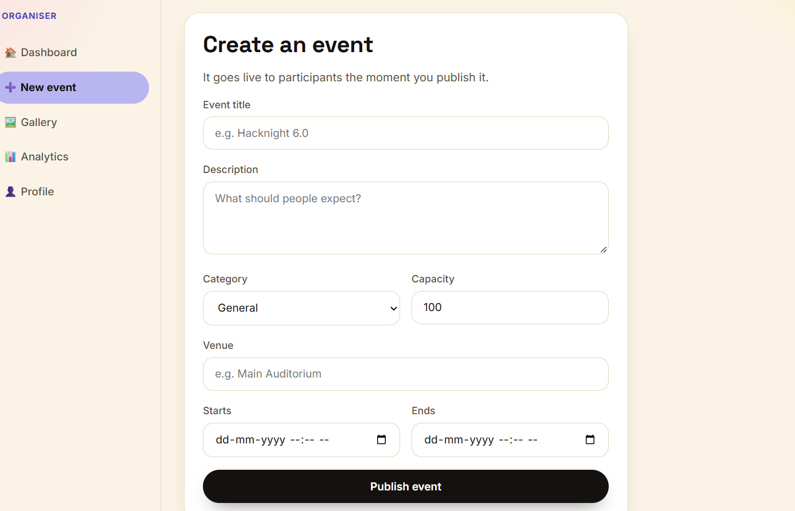
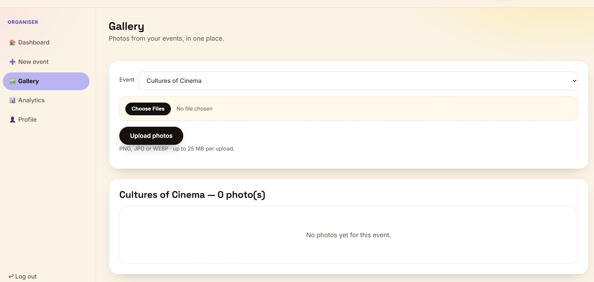
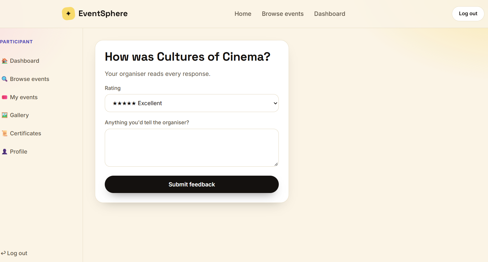

# EventSphere

**Event Management System with QR-Based Attendance & Certification**
BCA V · CN312 Project (MO 2026) · Guide: Dr. Amrita Priyam

EventSphere is a web app for running college events end-to-end: create an
event, let students register, hand out a QR pass, scan it at the door,
collect feedback, and auto-issue a PDF certificate — no spreadsheets.

## Roles

| Role | Can do |
|---|---|
| **Admin** | Approve/reject organiser (society) accounts, view all events, all participants, platform-wide analytics |
| **Organiser** | Create/edit events, view registrants, scan QR codes to mark attendance, see per-event analytics, upload gallery photos |
| **Participant** | Browse/search events, register, get a QR pass, view "my events", give feedback, download certificates |

## Tech stack

- **Backend:** Flask, Flask-SQLAlchemy, Flask-Login, Flask-Migrate, Flask-WTF
- **Database:** SQLite (via SQLAlchemy — swappable for Postgres later)
- **Frontend:** HTML5, CSS3 (custom design system, no Bootstrap dependency baked into the CSS tokens), JavaScript
- **QR codes:** `qrcode` (generation) + `html5-qrcode` (in-browser camera scanning, CDN)
- **Certificates:** ReportLab (PDF generation)
- **Charts:** Chart.js (CDN)

## Getting started

```bash
python -m venv venv
source venv/bin/activate        # Windows: venv\Scripts\activate
pip install -r requirements.txt

cp .env.example .env            # then edit SECRET_KEY

# Option A — fresh empty database
python run.py

# Option B — pre-loaded with demo accounts + events (recommended for a mentor demo)
python seed.py
python run.py
```

Visit `http://127.0.0.1:5000`. If you ran `seed.py`, log in with any of the
accounts printed in the terminal (all use password `password123`).

## Running tests

```bash
pip install pytest
pytest
```

Tests cover auth (register/login/role gating), event creation & ownership,
registration (incl. capacity limits & duplicate prevention), QR check-in
(incl. rejecting the wrong event's token and double check-ins), and
certificate issuance.

## Project structure

See the file tree in the repo root — routes are split by role
(`app/routes/admin.py`, `organiser.py`, `participant.py`, `auth.py`,
`main.py`), business logic lives in `app/services/` (QR generation,
certificate rendering, analytics aggregation), and templates mirror the
same role split under `app/templates/`.

## Roadmap / things we're deliberately keeping simple for now

- Feedback is a single 1–5 rating + comment (no multi-question forms)
- Certificates use a clean generated template, not a designed asset
- No email notifications yet (flash messages only)
- Photo gallery upload exists per-event but has no moderation step

These are intentional scope cuts per the synopsis ("a good basic structure
without getting into too much detail and complexity") — see PROGRESS.md
for what's planned across the review cycle.

## Team

| Roll | Name |
|---|---|
| BCA/40085/24 | Maanya Pratap |
| BCA/40081/24 | Nistha |
| BCA/40084/24 | Astha Kumari |
| BCA/40072/24 | Shreya S. Xaxa |

##Screenshots





